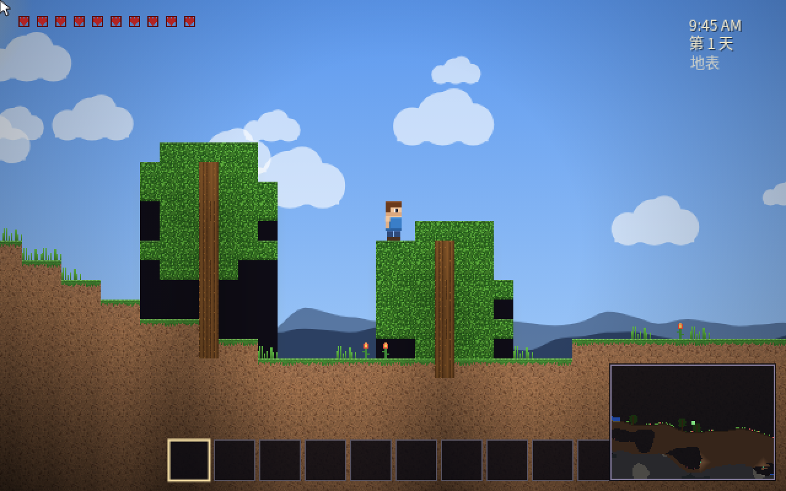
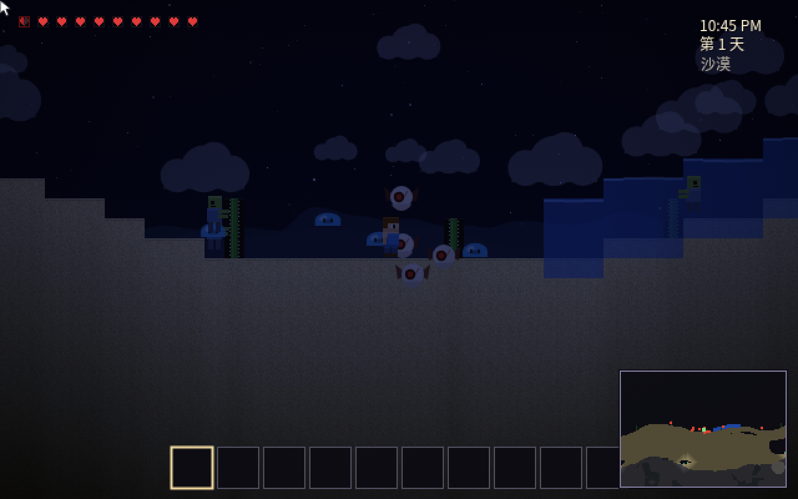
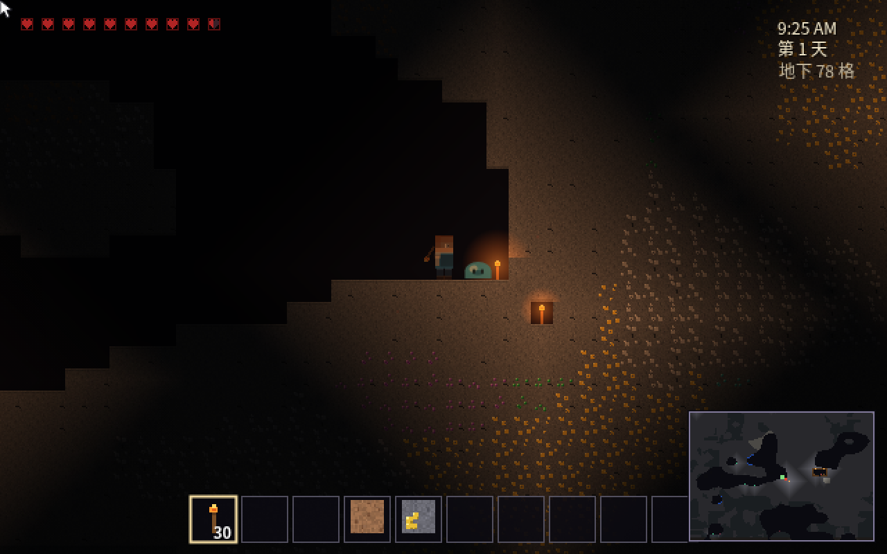
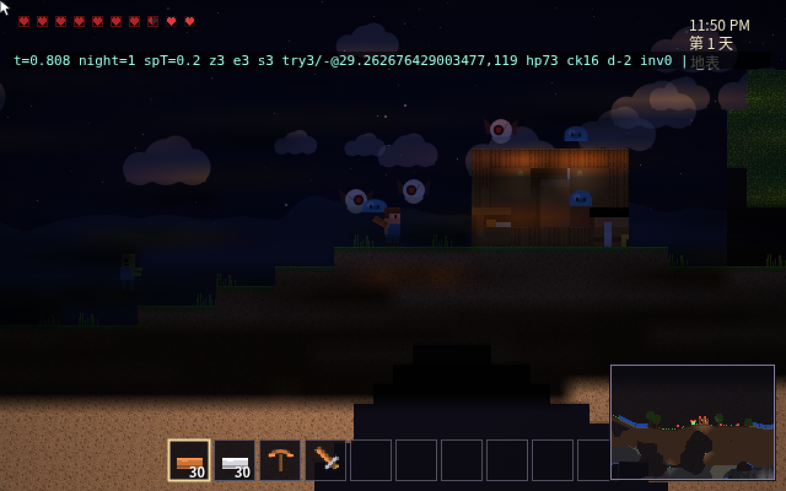
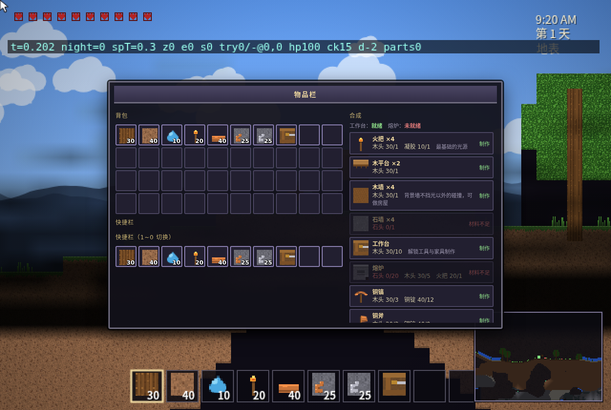

# Terra Nova · 泰拉式 2D 沙盒生存

> 由 **MiniMax-M3.1-Flash-Preview** 生成 ｜ 在线试玩：<https://bill-666code.github.io/terraria-like-MiniMax-M3.1-Flash-Preview/>

一个纯前端、零依赖的 **2D 侧视沙盒生存游戏**，玩法与画面向《泰拉瑞亚》靠拢：
无限横向程序化世界、可破坏地形、挖矿炼矿造工具、建房设门、昼夜交替、夜里刷僵尸。

直接用浏览器打开 `index.html` 就能玩（双击即可，不需要服务器、不需要联网）。

---

## 画面

| | |
|---|---|
|  白天地表：视差远山、云层、树木花草 |  夜晚：僵尸 / 恶魔眼 / 史莱姆 |
|  地下 78 格：金矿、紫水晶、绿宝石 |  木屋与火把照明 |
|  背包与合成（工作台就绪时解锁工具配方） | |

## 本次项目的提示词

本项目由 **MiniMax-M3.1-Flash-Preview** 生成，使用的项目提示词原文如下：

```text
生成一个类似泰拉瑞亚的2D侧视沙盒生存游戏：随机生成可破坏地形，玩家挖掘资源、建造房屋、制作工具武器，夜晚会生成僵尸，有昼夜交替。游戏的玩法和游戏的画面效果尽量贴近泰拉瑞亚。
```

## 快速开始

```bash
# 方式一：直接双击 index.html

# 方式二：起个本地服务（推荐，localStorage 存档更稳）
python3 -m http.server 8080
# 然后访问 http://127.0.0.1:8080/
```

## 操作

| 按键 | 功能 |
|---|---|
| `A` `D` / `←` `→` | 移动 |
| `空格` / `W` / `↑` | 跳跃（按住跳更高），`S` 从木平台落下 |
| 鼠标左键 | 挖掘（长按）/ 挥剑攻击 |
| 鼠标右键 | 放置方块 / 吃东西 / 开门 / 开箱 / 睡觉 |
| `1`~`0`、滚轮 | 切换快捷栏 |
| `E` | 打开背包 & 合成（靠近工作台/熔炉解锁更多配方） |
| `F` | 开关小地图　`M` 静音　`Q` 丢弃光标上的物品 |
| `Esc` | 关闭面板 |

## 玩法循环

1. **徒手挖土、砍树** → 泥土 / 木头
2. **合成**（徒手即可）：火把、木平台、木墙、工作台
3. **工作台**：铜/铁/金镐、斧、剑、箱子、门、床
4. **熔炉**：3 矿 → 1 锭（铜/铁/金），沙子 → 玻璃（每次熔炼消耗 1 木头或火把当燃料）
5. **往下挖**：铜铁金矿脉 + 紫水晶/黄玉/绿宝石，越深越危险
6. **天黑之前**：造一间有火把和门的小屋（背景墙不挡碰撞、火把才给光）
7. **夜晚**：僵尸从地表爬上来，恶魔眼在天上飞，洞穴里有蓝史莱姆
   - 偶尔会来 **血月**：天红、敌人更多更凶
8. 死了在出生点复活（背包不掉落），床可以重设重生点、并在夜里直接睡到天亮

## 世界

- 宽度无限，高度 320 格（1 格 = 16 像素）
- 4 个层次：地表（平原/森林/沙漠）→ 泥土层 → 石层/深板岩/大理石 → 下界（灰烬 + 狱石 + 岩浆海）
- 洞穴由噪声挖出，洞穴里有水洼、荧光苔、蘑菇
- 地底偶尔埋着木屋小舱：工作台、火把、装满战利品的箱子
- 昼夜 12 分钟一轮：日出日落有暖色过渡，夜晚星星月亮出来、云变暗

## 技术

- 纯 `HTML + CSS + 原生 JS`，无框架、无图片资源：**所有像素贴图都是代码生成的**（Canvas 逐像素画出来）
- 光照：方块光源 BFS + 天空光扩散，逐格算完后画成一张低分辨率光图，用 `multiply` 缩放叠加到整幅画面上（所以光边缘是平滑的）
- 地形噪声做了两级优化：先在 1/4 格分辨率上预计算噪声场，再按列插值采样，一个区块约 7~10ms
- 存档：只序列化玩家改动过的区块（RLE 压缩）+ 背包 + 箱子，存在 `localStorage`

## 目录

```
index.html        页面 + UI 样式
js/core.js        数学 / 噪声 / 随机 / 音效合成 / 输入
js/tiles.js       方块·物品·配方定义 + 程序化像素贴图
js/world.js       区块生成、方块读写、液体、光照 BFS、存档
js/entities.js    玩家物理、僵尸/恶魔眼/史莱姆 AI、掉落物、粒子、背包
js/render.js      天空、视差背景、光照贴图、实体绘制、HUD、小地图
js/ui.js          背包 / 合成 / 熔炉 / 箱子 / 提示
js/main.js        主循环、输入处理、昼夜、脚本化调试接口
test/headless.js  Node 无头回归测试（模拟 DOM/Canvas 跑完整玩法）
test/trace.js     渲染调用追踪（排查画面问题用）
```

## 自测

```bash
node test/headless.js
```

会依次验证：贴图生成、区块生成与地形统计、玩家物理、挖掘掉落、
工具等级门槛、光照增删、家具多格、合成、液体数值合法性、
刷怪与战斗、存档读档、连续 300 帧渲染无异常。

## 调试参数（URL）

| 参数 | 作用 |
|---|---|
| `?auto=1` | 跳过标题界面直接开局 |
| `?seed=123` | 指定世界种子 |
| `?t=0.7` | 指定初始时间（0=4:30AM，0.5=4:30PM，0.7≈夜里） |
| `?give=5*30,20*10` | 赠送物品（物品ID*数量） |
| `?warm=25` | 快进 25 秒模拟 |
| `?debug=1` | 屏幕左上角显示帧率/深度/敌人数等 |
| `?only=sky,tile,liq,ent,light,wall,hud` | 只渲染指定图层 |
| `?perf=120` | 测量 120 帧的渲染耗时 |
| `?act=mine:2,1,8,place:3,house,findcave` | 脚本化操作（挖掘/放置/建屋/找洞/探针） |

例：`index.html?auto=1&seed=42&t=0.7&warm=20&debug=1` —— 直接进夜晚的夜晚世界。
